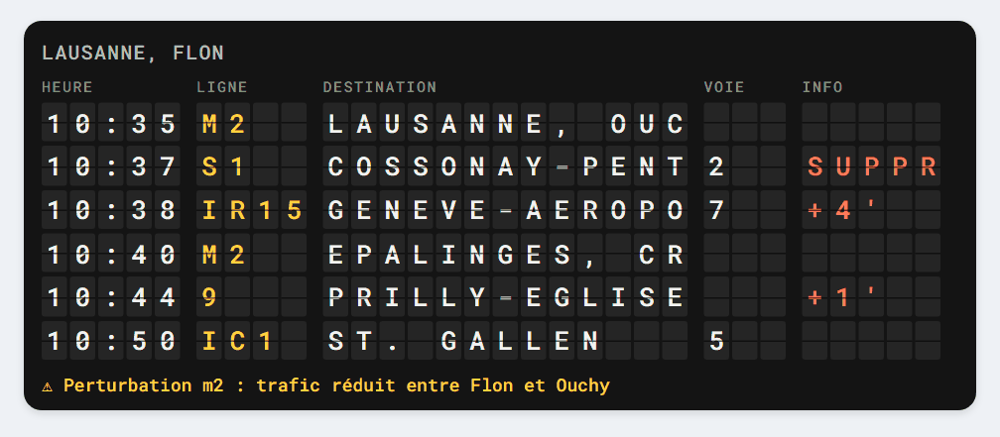
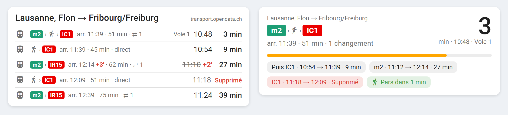
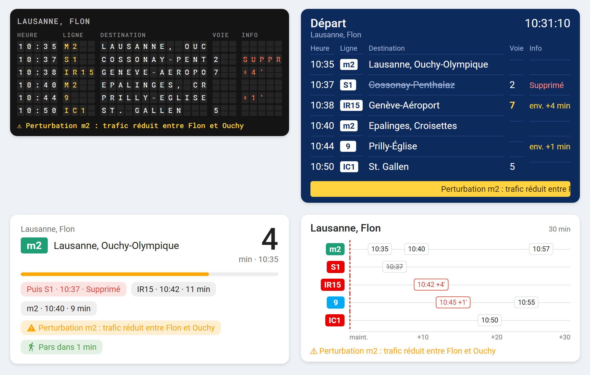
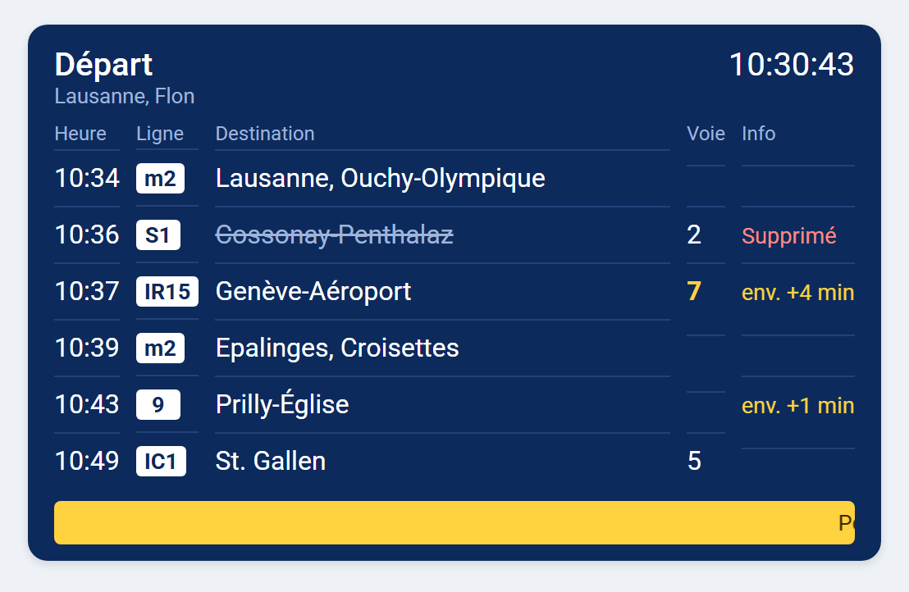
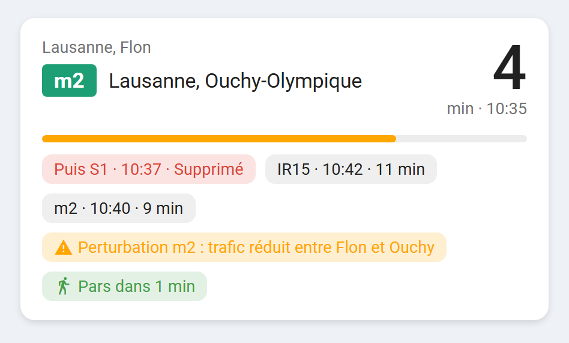
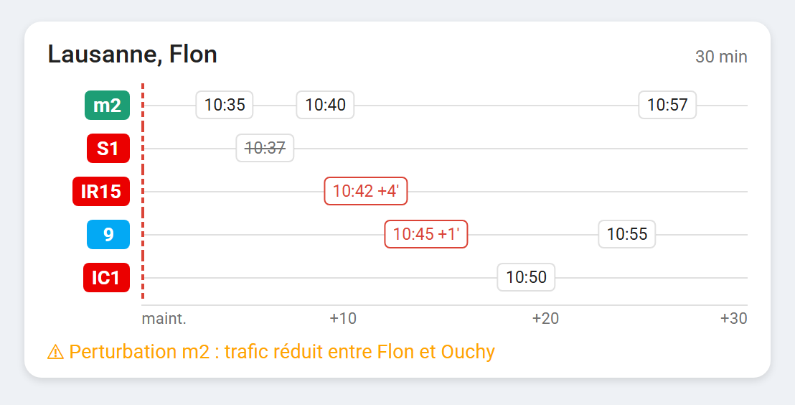
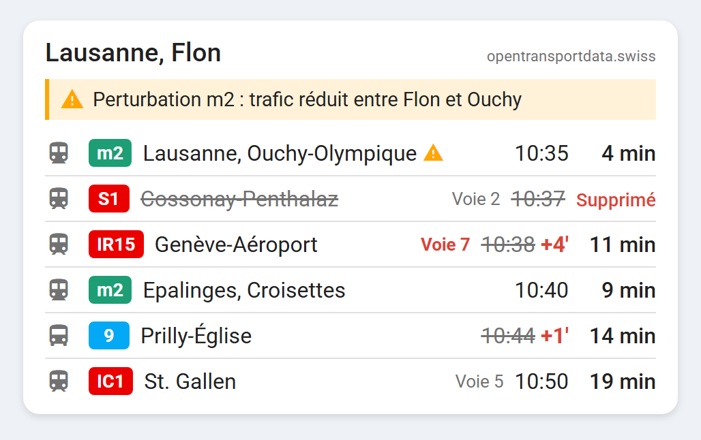
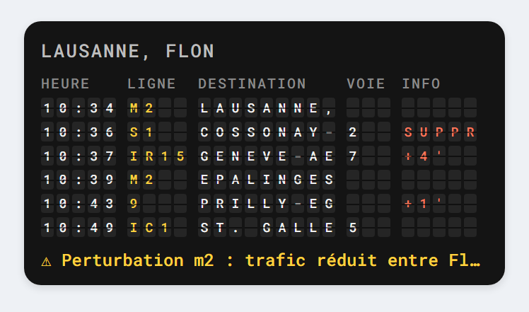

# Swiss Transit For HA


**Your stop's departure board, live in Home Assistant.**
Every bus, tram, train, metro, boat and cable car in Switzerland, with real-time delays, cancellations, platform changes and disruption messages. Pick your stop, nothing to program.

[](https://my.home-assistant.io/redirect/hacs_repository/?owner=SashConnection&repository=swisstransit4HA&category=integration)

   

🇫🇷 **[En français plus bas](#-en-français)**



<sub>The split-flap style: letters spin like on a real station board when a departure leaves, a delay appears or a train is cancelled.</sub>

## Never run for the bus again

- 🚏 **Any stop in Switzerland**: type *Lausanne, Flon*, *Bern* or *Zürich, Paradeplatz* and you're done
- 🧭 **Or just your trip**: from home to work, with changes, arrival time and travel time
- ⏱️ **Real time**: expected time, delay in minutes, cancelled departures, platform changes
- 🚶 **Leave on time**: give your walking time, departures you can't catch disappear and the card tells you *leave in 3 min*
- ⚠️ **Disruptions**: official messages for your lines, right on the card
- 🔔 **Automations**: a *Disruption* sensor to get a notification on your phone before you leave home
- 🎯 **Only what matters**: filter by line (`9, 21, S3`), direction (`Genève`) or means of transport
- 🎨 **Five card styles**, ready to use, in French, German, Italian and English

## Just your trip, from A to B

Only one journey matters to you? Choose **A trip from A to B** when you add the integration: you get the next connections that actually take you there, even when your stop is not the terminus or you have to change.



Departure and arrival time with real-time delays, travel time, changes and the vehicles to take (here metro m2, a short walk, then the IC1). Works with all five card styles.

## Five styles, one click

Pick your favourite in the card editor.



| | |
|---|---|
| **Split-flap board** (`flap`)<br>The old station board, with spinning letters.<br><br> | **Platform display** (`platform`)<br>Live clock, blinking delays, scrolling disruption banner.<br><br> |
| **Next departure, large** (`countdown`)<br>Readable from across the room. Perfect for a wall tablet by the door.<br><br> | **Timeline** (`timeline`)<br>The next 30 minutes, one row per line: bus or metro?<br><br> |
| **List** (`list`)<br>Clean and compact, fits any dashboard.<br><br> | **On your phone**<br>Every style adapts to narrow screens.<br><br> |

<sub>Screenshots with example data.</sub>

## Installation in 3 steps

1. **Install**: click the *Open in HACS* button above, or in HACS → ⋮ → *Custom repositories* add `https://github.com/SashConnection/swisstransit4HA` (category *Integration*). Install *Swiss Transit For HA* and restart Home Assistant.
2. **Add your stop or your trip**: *Settings → Devices & services → Add integration → Swiss Transit For HA*, then choose *Departures from a stop* or *A trip from A to B* and type the names. Optional filters: lines, direction, walking time.
3. **Add the card**: on a dashboard, *Add card → Swiss Transit departures*, pick a style.

Add the integration once per stop or direction, e.g. *Lausanne → Genève* and *Lausanne → Bern*.

## Free, with an optional key for more

It works right away, without account or key. A free key unlocks real time for buses and trams.

| | Without key | With a free key |
|---|---|---|
| Source | [transport.opendata.ch](https://transport.opendata.ch) | [opentransportdata.swiss](https://opentransportdata.swiss) (OJP 2.0) |
| Timetable of every stop | ✅ | ✅ |
| Real-time delays | trains, some city networks | almost every operator, buses and trams included |
| Cancellations | ❌ | ✅ |
| Disruption messages | ❌ | ✅ |

**Get a key in 2 minutes:** create an account on [api-manager.opentransportdata.swiss](https://api-manager.opentransportdata.swiss), create an application, subscribe it to **OJP 2.0** and copy the key into the integration options. Each user needs their own key: it's free and personal.

## Automation ideas

**Notify me when my train is late, on weekday mornings:**

```yaml
alias: Train late
triggers:
  - trigger: state
    entity_id: binary_sensor.lausanne_disruption
    to: "on"
conditions:
  - condition: time
    after: "06:30:00"
    before: "08:30:00"
    weekday: [mon, tue, wed, thu, fri]
actions:
  - action: notify.mobile_app_my_phone
    data:
      title: "🚆 Disruption at Lausanne"
      message: >
        {{ (state_attr('binary_sensor.lausanne_disruption', 'alerts')
            + state_attr('binary_sensor.lausanne_disruption', 'delayed')
            + state_attr('binary_sensor.lausanne_disruption', 'cancelled')) | join(', ') }}
```

**Say it out loud when you open the front door:**

```yaml
actions:
  - action: tts.speak
    target:
      entity_id: tts.home_assistant_cloud
    data:
      media_player_entity_id: media_player.hallway
      message: >
        Bus {{ state_attr('sensor.lausanne_flon_next_departure', 'line') }}
        to {{ state_attr('sensor.lausanne_flon_next_departure', 'destination') }}
        in {{ ((as_timestamp(states('sensor.lausanne_flon_next_departure')) - now().timestamp()) / 60) | round }} minutes.
```

## Entities (per stop)

| Entity | State | Attributes |
|---|---|---|
| `sensor.<stop>_next_departure` | departure time (real time when known) | line, destination, platform, delay, cancelled; for a trip also arrival, duration, transfers, route |
| `sensor.<stop>_second_departure`, `_third_departure` | same | same |
| `sensor.<stop>_delay` | delay of the next departure, in minutes | |
| `sensor.<stop>_departure_board` | number of departures | `departures` and `alerts` lists, for the card and templates |
| `sensor.<stop>_alerts` | number of active messages | `alerts` |
| `binary_sensor.<stop>_disruption` | on when a message is active, a departure is cancelled or late | `alerts`, `cancelled`, `delayed` |

Entity names follow your Home Assistant language.

## Card options (YAML)

```yaml
type: custom:swisstransit-departures-card
entity: sensor.lausanne_flon_departure_board
style: flap          # list, flap, platform, countdown, timeline
max: 8               # optional, number of departures
window: 30           # optional, timeline length in minutes
show_platform: true  # optional
show_alerts: true    # optional
title: To work       # optional
```

---

## 🇫🇷 En français

**Le tableau des départs de ton arrêt, en direct dans Home Assistant.**
Tous les bus, trams, trains, métros, bateaux et remontées mécaniques de Suisse, avec les retards en temps réel, les suppressions, les changements de voie et les messages de perturbation. Tu choisis ton arrêt, il n'y a rien à programmer.

- 🚏 **N'importe quel arrêt en Suisse** : tape *Lausanne, Flon*, *Bern* ou *Zürich, Paradeplatz*, c'est tout
- 🧭 **Ou juste ton trajet** : de la maison au travail, avec les changements, l'heure d'arrivée et la durée. Même si ton arrêt n'est pas le terminus ou s'il faut changer, seules les correspondances qui t'y emmènent sont affichées
- ⏱️ **Temps réel** : heure prévue, retard en minutes, départs supprimés, changements de voie
- 🚶 **Pars à l'heure** : indique ton temps de marche, les départs que tu ne peux plus attraper disparaissent et la carte te dit *pars dans 3 min*
- ⚠️ **Perturbations** : les messages officiels de tes lignes, directement sur la carte
- 🔔 **Automatisations** : un capteur *Perturbation* pour recevoir une notification avant de partir
- 🎨 **Cinq styles de carte** : liste, tableau à palettes (les lettres tournent comme dans les gares), affichage de quai, prochain départ en grand (idéal pour une tablette murale) et frise des 30 prochaines minutes

**Installation en 3 étapes :**

1. Clique sur le bouton *Open in HACS* en haut, ou dans HACS → ⋮ → *Dépôts personnalisés* ajoute `https://github.com/SashConnection/swisstransit4HA` (catégorie *Intégration*). Installe *Swiss Transit For HA* et redémarre Home Assistant.
2. *Paramètres → Appareils et services → Ajouter une intégration → Swiss Transit For HA*, choisis *Les départs d'un arrêt* ou *Un trajet de A à B*, puis tape les noms. Filtres optionnels : lignes, direction, temps de marche.
3. Sur un tableau de bord : *Ajouter une carte → Swiss Transit departures*, puis choisis un style.

**Gratuit, avec une clé optionnelle pour aller plus loin :** sans clé, ça marche tout de suite avec transport.opendata.ch, avec le temps réel surtout pour les trains. Une clé gratuite [opentransportdata.swiss](https://api-manager.opentransportdata.swiss) abonnée à **OJP 2.0** ajoute le temps réel des bus et trams, les suppressions et les messages de perturbation. Elle se colle dans les options de l'intégration. Chaque utilisateur crée la sienne, c'est gratuit et personnel.

---

Data: [opentransportdata.swiss](https://opentransportdata.swiss) (Open Data Platform Mobility Switzerland) and [transport.opendata.ch](https://transport.opendata.ch). This project is not affiliated with SBB CFF FFS or any transport company.

MIT License
